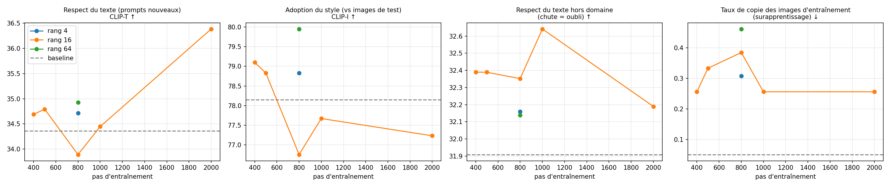

# Adapter un modèle texte-image avec LoRA — zellige marocain

Spécialisation de **Stable Diffusion 1.5** sur un domaine précis (le *zellige* marocain) avec une **LoRA**
(petite adaptation des couches d'attention de l'UNet), à partir de **20 à 50 images autorisées**, sur un GPU de **12 Go de VRAM maximum**
(Google Colab T4 / Kaggle).

> Équipe : voir [`docs/TEAM.md`](docs/TEAM.md) · Rapport : [`report/rapport.md`](report/rapport.md) · Plan de soutenance : [`docs/SOUTENANCE.md`](docs/SOUTENANCE.md)

## Résultats principaux
*À compléter après l'évaluation (notebook 03) : tableau `results/metrics_summary.csv`, figures `results/figures/`.*

| Modèle | CLIP-T nouveau ↑ | Style (test) ↑ | Taux de copie ↓ | CLIP-T hors domaine ↑ | Temps | Pic VRAM |
|---|---|---|---|---|---|---|
| baseline | | | | | – | – |
| LoRA r=4 @800 | | | | | | |
| LoRA r=16 @800 | | | | | | |
| LoRA r=64 @800 | | | | | | |



## Structure du dépôt
| Dossier | Contenu |
|---|---|
| `notebooks/` | `00_donnees`, `01_baseline`, `02_entrainement_lora`, `03_evaluation`, `04_demo` |
| `src/` | `data_utils.py` (données), `train_lora.py`, `run_experiments.py`, `generate.py`, `evaluate.py` |
| `configs/` | `data.yaml`, `train_base.yaml`, `experiments.yaml`, `prompts.yaml`, `eval.yaml` |
| `data/` | `metadata.csv` (licences, auteurs, légendes) ; images ignorées par Git ; `DATA_CARD` dans `docs/` |
| `results/` | métriques CSV, figures, grilles d'exemples |
| `demo/` | `app.py` (Gradio) + vidéo de démonstration |
| `report/` | rapport final |
| `docs/` | fiche des données, fiche du modèle, éthique, licences, plan de travail |
| `tests/` | tests de la chaîne de données (`pytest -q`, sans GPU) |

## Lancer sur Google Colab / Kaggle (GPU T4, activer Internet sur Kaggle)
1. Poussez ce dépôt sur GitHub, puis dans chaque notebook remplacez `REPO_URL` par l'URL de votre dépôt.
2. Ouvrez `notebooks/00_donnees.ipynb` dans Colab (*Fichier > Ouvrir > GitHub*) avec un GPU (*Exécution > Modifier le type d'exécution*), puis exécutez les notebooks dans l'ordre.

Ou en ligne de commande (depuis la racine, GPU requis pour l'entraînement) :
```bash
pip install -r requirements.txt
python -m src.data_utils download            # images Wikimedia Commons sous licence libre
#  -> relire les légendes de data/metadata.csv (reviewed=1), commiter ce fichier
python -m src.data_utils prepare && python -m src.data_utils check
python -m src.train_lora --config configs/train_base.yaml --rank 16 --steps 800    # un run
python -m src.run_experiments --experiments configs/experiments.yaml               # toute la grille
python -m src.evaluate --config configs/eval.yaml                                  # métriques + figures
python demo/app.py --lora outputs/r16_s800/checkpoint-800 --share                  # démo interactive
```
Nouvelle session Colab : `python -m src.data_utils fetch` re-télécharge les images listées dans `metadata.csv`
(les photos personnelles vont dans `data/own/`, à commiter). Sauvegardez `outputs/` sur Google Drive (copie) ou en *release* GitHub : les LoRA pèsent 3 à 60 Mo.

## Choix techniques (12 Go de VRAM)
Poids gelés en fp16 · LoRA (rang r, `alpha = r`) sur `to_q, to_k, to_v, to_out` de l'UNet, entraînée en fp32 avec autocast fp16 ·
latents et embeddings de texte mis en cache (VAE et encodeur de texte libérés) · gradient checkpointing · batch 2 · 512×512.
Le pic de VRAM réel est mesuré et écrit dans `outputs/<run>/run_info.json`.

## Évaluation
Voir `src/evaluate.py` : respect du texte (CLIP-T), adoption du style sur images de test jamais vues, taux de copie des images d'entraînement
(surapprentissage), oubli hors domaine, coût (temps, VRAM, paramètres) + grilles visuelles identiques en graines pour tous les modèles.

## Licences et éthique
Code : MIT. Modèle de base : CreativeML OpenRAIL-M. Images : voir `data/metadata.csv` (auteur, licence, URL de chaque image).
Détails : [`docs/LICENSES.md`](docs/LICENSES.md), [`docs/ETHICS.md`](docs/ETHICS.md), [`docs/MODEL_CARD.md`](docs/MODEL_CARD.md).
