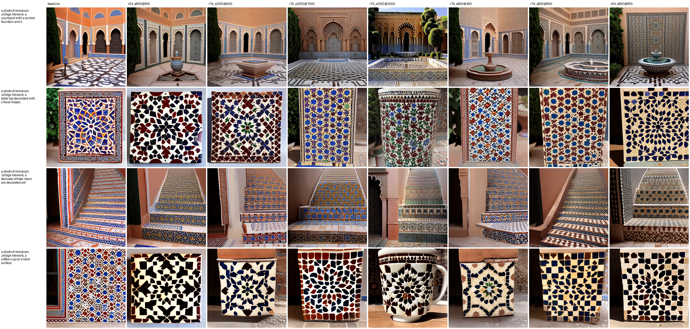

# Adapter un modèle texte-image avec LoRA : zellige marocain

## Présentation

Ce projet spécialise **Stable Diffusion 1.5** sur un domaine précis, le *zellige* marocain, avec une **LoRA** : une petite adaptation ajoutée aux couches d'attention du UNet, sans réentraîner tout le modèle.

- **Données** : 20 à 50 images sous licence libre (Wikimedia Commons, photos de l'équipe), légendées à la main, recadrées en 512×512, avec 5 à 10 images réservées au test.
- **Expériences** : comparaison de plusieurs rangs LoRA (4, 16, 64) et nombres d'étapes (200 à 800, plus un run long pour provoquer le surapprentissage).
- **Évaluation** : respect du texte (CLIP-T), adoption du style, taux de copie des images d'entraînement, oubli hors domaine, coût (temps, VRAM, paramètres), exemples visuels.
- **Démonstration** : application Gradio avec prompt libre, réglage de l'intensité de la LoRA et comparaison avant/après.
- **Contrainte** : GPU de **12 Go de VRAM maximum** (Google Colab ou Kaggle, T4).

## Installation

### Sur Google Colab ou Kaggle (recommandé)
1. Ouvrir `notebooks/00_donnees.ipynb` dans Colab (*Fichier > Ouvrir le notebook > GitHub*, puis l'URL de ce dépôt), ou l'importer dans Kaggle (activer *Internet*).
2. Activer un GPU : *Exécution > Modifier le type d'exécution > GPU T4*.
3. La première cellule de chaque notebook clone le dépôt et installe les dépendances automatiquement.

### En local
Python 3.10 ou plus, et un GPU NVIDIA pour l'entraînement (PyTorch à installer d'abord : https://pytorch.org).
```bash
git clone https://github.com/Aya-KB/lora-moroccan-ornaments.git
cd lora-moroccan-ornaments
python -m venv .venv
source .venv/bin/activate          # Windows : .venv\Scripts\activate
pip install -r requirements.txt
python -m pytest -q tests          # test de la chaîne de données (sans GPU)
```

## Commande de lancement

Depuis la racine du dépôt :
```bash
python -m src.data_utils download        # 1. télécharge des images sous licence libre
python scripts/review_captions.py        # 2. relecture des légendes (reviewed=1) et exclusions
python -m src.data_utils prepare         # 3. 512x512, doublons, séparation train/test
python -m src.data_utils check           # 4. contrôle des licences, légendes et effectifs

python -m src.train_lora --config configs/train_base.yaml --rank 16 --steps 800   # un entraînement
python -m src.run_experiments --experiments configs/experiments.yaml              # toute la grille

python -m src.evaluate --config configs/eval.yaml                                 # métriques et figures
python demo/app.py --lora outputs/r16_s800/checkpoint-800 --share                 # démo interactive
```
Notebooks, à exécuter dans l'ordre : `00_donnees`, `01_baseline`, `02_entrainement_lora`, `03_evaluation`, `04_demo`.

Nouvelle session Colab : `python -m src.data_utils fetch` re-télécharge les images listées dans `data/metadata.csv`. Les poids LoRA (3 à 60 Mo) ne sont pas versionnés dans Git : copiez `outputs/` sur Google Drive.

## Résultats principaux

*À compléter après l'évaluation (notebook 03) avec `results/metrics_summary.csv`.*

| Modèle | CLIP-T (prompts nouveaux) ↑ | Style (images de test) ↑ | Taux de copie ↓ | CLIP-T hors domaine ↑ | Temps d'entraînement | Pic VRAM |
|---|---|---|---|---|---|---|
| Baseline (sans LoRA) | | | | | – | – |
| LoRA rang 4, 800 pas | | | | | | |
| LoRA rang 16, 800 pas | | | | | | |
| LoRA rang 64, 800 pas | | | | | | |



